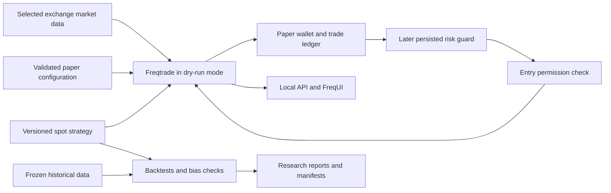

# Architecture, fork, and version control

## Repository boundary and safe bootstrap

The current `/Users/myomyinthan/Documents/AiTrading/FreqTradingBot` directory holds planning artifacts. It is not yet the intended personal GitHub fork. Do not run `git clone ... .` into this non-empty directory, overwrite it with a checkout, or initialize it as an unrelated project and then splice in upstream history.

Proposed safe destination: `/Users/myomyinthan/Documents/AiTrading/FreqTradingBot/freqtrade`. Clone into this new child directory only if it does not exist. If it already exists, inspect its Git status and remotes and reuse it only when it is the correct checkout. Copy this pack into the fork at `bot/docs/plans/` after cloning; preserve the original planning files. Avoid duplicating plans under upstream's own `docs/` tree.

Future bootstrap sequence, after the user starts implementation:

1. Read any newly present `AGENTS.md`; inspect the filesystem and Git status. Recheck GitHub authentication without exposing tokens. If unavailable, continue local preparation and report that the remote fork step is blocked.
2. Confirm the authenticated owner and inspect whether that owner already has a fork of `freqtrade/freqtrade`. Reuse the correct fork. Otherwise create one under that verified owner; record its URL and privacy constraints before putting project material in it. The command below creates a personal fork for the authenticated user, so `BOT_GH_OWNER` must match that user. Organization ownership or a renamed repository needs a deliberately adapted command. A public upstream fork must never be treated as a private secrets store.
3. Clone the owned fork into the new destination. Set `origin` to the personal fork and `upstream` to `https://github.com/freqtrade/freqtrade.git`. Verify both directions; do not push to upstream.
4. Fetch upstream release tags and inspect release notes. Select a released stable version, resolve its full commit SHA, and make a project branch from that SHA. Do not base the project on whatever upstream's default `develop` happens to contain.
5. Copy plans into `bot/docs/plans/`, implement the overlay, and create small reviewable commits on `bot/main` or a task branch derived from it. Preserve upstream licensing and attribution.

Git command templates, not executed by this plan:

```sh
# BOT_GH_OWNER and BOT_RELEASE_TAG must be verified values, not guessed defaults.
gh auth status
gh repo view "$BOT_GH_OWNER/freqtrade" --json nameWithOwner,isFork,parent,url
# Only when the preceding inspection confirms no suitable fork exists:
gh repo fork freqtrade/freqtrade --clone=false

cd /Users/myomyinthan/Documents/AiTrading/FreqTradingBot
git clone "https://github.com/$BOT_GH_OWNER/freqtrade.git" freqtrade
cd freqtrade
git remote add upstream https://github.com/freqtrade/freqtrade.git
git remote -v
git fetch upstream --tags
git rev-parse "$BOT_RELEASE_TAG^{commit}"
# Inspect the resolved SHA and release before creating this branch.
git switch -c bot/main "$BOT_RELEASE_TAG"
mkdir -p bot/docs
cp -R ../docs/plans bot/docs/plans
```

These steps need adaptation when a fork, remote, or branch already exists. Avoid destructive cleanup, reset, force push, or automatic branch replacement. Review copied files and staged changes before pushing.

## Project overlay

Keep upstream engine code unchanged initially. Use supported strategy/configuration interfaces. A core patch requires a separate rationale, focused tests, and an upstream maintenance cost assessment.

```text
freqtrade/                       # personal fork checkout; upstream files retained
  bot/
    README.md                    # runnable project instructions and safe defaults
    VERSION.lock.json            # release tag, upstream SHA, image digest/platform
    compose.yaml                 # pinned runtime; explicit project mount paths
    .gitignore                   # secrets/runtime/reports/cache exclusions
    configs/
      base.example.json          # tracked, credential-free, spot + dry_run true
      research.example.json      # tracked deterministic research settings
      pilot.example.json         # tracked paper profile, no live credentials
      exchange-capabilities.md   # verified venue-specific behavior and dates
    strategies/
      PersonalSpotBaseline.py    # sole initial strategy
    risk/
      guard.py                   # separate persisted equity/entry permission guard
      schema.py                  # explicit accounting and heartbeat schema
    scripts/
      preflight.py               # fail closed on invalid or unsafe pilot config
      run_research.py            # manifested commands and run-directory creation
      check_data.py              # continuity/quality validation
      report_results.py          # metrics + cost stress + provenance
    tests/                       # deterministic project tests, no network/keys
    docs/plans/                  # this pack, decisions, readiness evidence
    research/
      protocol.yaml              # frozen dates, hypothesis, gates, attempted variants
      manifests/                 # tracked small metadata/checksums, no credentials
    secrets/                     # ignored; file permissions restricted
    runtime/                     # ignored; mounted writable separately
      research/                  # isolated research userdir and generated results
      paper/                     # dry-run DB/logs/guard state
      live/                      # reserved, never used by initial implementation
      data/                      # immutable research snapshots by dataset ID
    reports/                     # ignored bulky results; sanitized summaries tracked
```

The inspected upstream ignore patterns include `config*.json`, `user_data/*`, and `docker-compose-*.yml`; this is why names such as `base.example.json` and `compose.yaml` are proposed. Verify actual tracking with `git check-ignore -v` and `git ls-files`. Do not bypass broad ignore rules with `git add -f` on secrets or whole runtime folders. Freqtrade's runtime user directory can be mounted separately from the read-only tracked strategy directory through explicit `--userdir` and `--strategy-path` arguments.

## Runtime design



The initial paper engine simulates orders; it must not send funded orders to the exchange. The guard is added in M4 and evaluated separately from the historical research path.

Market data goes from the selected exchange to Freqtrade. The strategy uses closed candles and submits intentions through Freqtrade's execution/risk interfaces. Freqtrade owns orders and its database. A separate local guard reads a normalized account-equity feed and writes atomic entry-permission state; the strategy reads that small state at order confirmation and the guard invokes the verified API entry-pause operation when needed. No component edits Freqtrade's database tables directly.

The guard and Freqtrade may be two Compose services on one private network. Bind any UI/API host port to `127.0.0.1`; permit guard access only over the private network. Mount strategies/config examples read-only, runtime directories writable, and secrets only where needed. Use unique paper and future live service names, DB paths, API credentials, and ports. Do not start two writers against one DB.

## Reproducibility contract

`VERSION.lock.json` must record: upstream release tag and full SHA, selected image repository and immutable `sha256` digest, CPU platform, `freqtrade --version`, dependency/runtime identity, and date checked. Capture the overlay Git SHA and dirty status in the generated run/release manifest after committing, not inside a lockfile that would then change its own commit identity. Mutable `stable` or numbered tags alone are insufficient. Record how the image corresponds to the chosen source release; reject a mismatch. With an unmodified engine, an official image is appropriate. If a core patch becomes necessary, build from the fork SHA, pin base images/dependencies, record the resulting image digest, and test that image.

At every run capture exact command arguments, sanitized effective config and hash, strategy/guard hashes, pair universe, dataset IDs/checksums, fee assumptions, timerange, timezone, random seeds where applicable, and test outputs. Keep secrets out of manifests. Retain raw artifacts outside Git with checksums and a storage location. Freeze source data per experiment; downloading updates into a frozen dataset invalidates its checksum.

## Upstream updates and rollback

Track upstream release/security announcements manually at first; propose a periodic review, not unattended runtime upgrades. For an update: create an integration branch, review release notes/config migrations/dependency changes, merge the selected stable release into the project branch, resolve conflicts, update the lockfile, and rerun project tests plus relevant upstream tests. Repeat strategy bias checks, a fixed historical regression dataset, and the dry-run restart/guard drills before promotion.

A release bundle includes image digest, source/overlay SHAs, sanitized config, compatible DB backup, dataset identifiers, and evidence. Back up before DB migrations. Never blindly run an older binary on a migrated DB; restore a tested compatible backup only after reconciling positions/orders. Exchange APIs change, so a successful old build is not enough to establish compatibility today. [Freqtrade updating guidance](https://www.freqtrade.io/en/stable/updating/).
